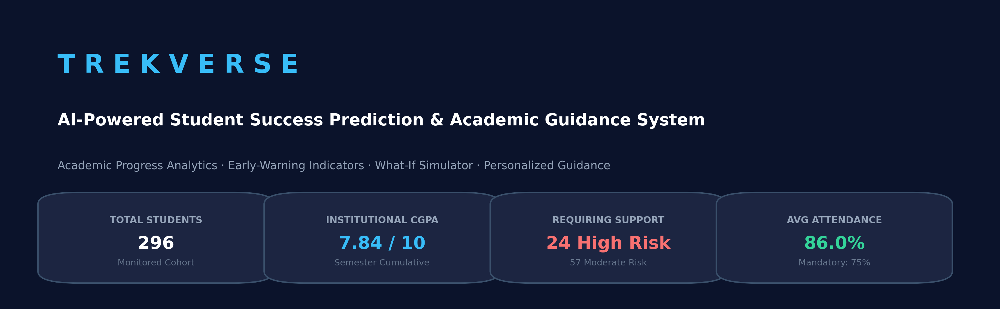
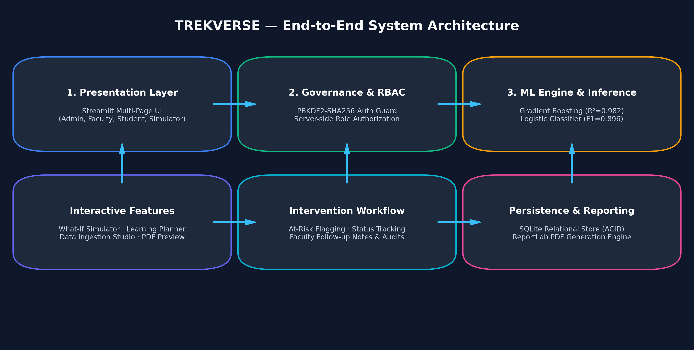
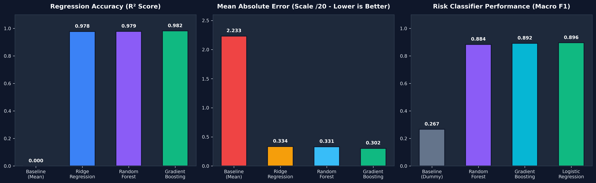
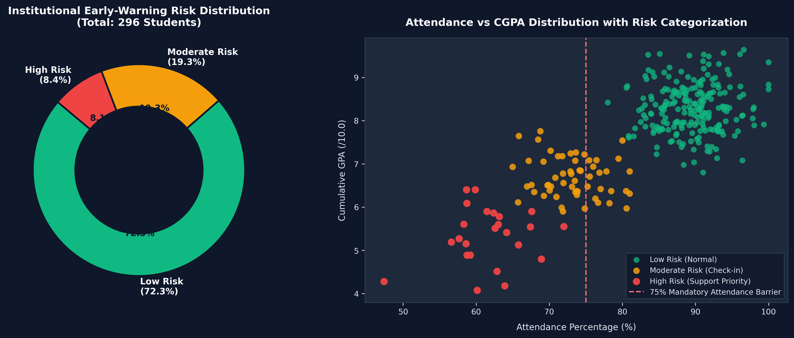

<div align="center">

# 🎓 TREKVERSE — AI-Powered Student Success Prediction & Academic Guidance System

### *Empowering Higher Education with Explainable Predictive Analytics, Early-Warning Risk Forecasting, and Personalized Learning Roadmaps*

[](https://www.python.org/)
[](https://streamlit.io/)
[](https://scikit-learn.org/)
[](https://www.sqlite.org/)
[](https://www.reportlab.com/)
[-10B981?style=for-the-badge&logo=pytest&logoColor=white)](https://github.com/Tharun-720/AI-Powered-Student-Success)
[](https://opensource.org/licenses/MIT)

---

### 🌐 Quick Links & Live Demonstrations
**[💻 Launch Web Application (Local: 8501)](http://localhost:8501)** • **[📂 GitHub Repository](https://github.com/Tharun-720/AI-Powered-Student-Success)** • **[📄 Sample Official PDF Report](reports/sample_STU1024.pdf)** • **[🧪 Run Test Suite](#-automated-testing--validation)**

---



</div>

<br/>

## 📖 Table of Contents
- [🌟 Executive Summary](#-executive-summary)
- [🎯 Core Capabilities & Highlights](#-core-capabilities--highlights)
- [🏛️ System Architecture & Workflow](#️-system-architecture--workflow)
- [📊 Machine Learning Benchmark Evaluation](#-machine-learning-benchmark-evaluation)
- [🚨 Early-Warning Monitoring & Risk Bands](#-early-warning-monitoring--risk-bands)
- [🔮 Interactive What-If Scenario Simulator](#-interactive-what-if-scenario-simulator)
- [📅 AI-Personalized Learning Planner](#-ai-personalized-learning-planner)
- [📄 Publication-Grade PDF Academic Reports](#-publication-grade-pdf-academic-reports)
- [👥 Role-Based Access Control & Demo Accounts](#-role-based-access-control--demo-accounts)
- [📂 Project Directory Structure](#-project-directory-structure)
- [🚀 Quick Start & Installation](#-quick-start--installation)
- [🧪 Automated Testing & Validation](#-automated-testing--validation)
- [⚖️ Responsible AI Notice](#️-responsible-ai-notice)

---

## 🌟 Executive Summary

The **TREKVERSE AI-Powered Student Success Prediction & Academic Guidance System** is an enterprise-grade academic decision-support platform designed for modern higher education institutions. Rather than predicting only a static final grade, the platform bridges data-driven machine learning forecasting with transparent human-in-the-loop interventions.

### 📈 Live Institutional Baseline Metrics (Benchmark Cohort)
| 👥 Monitored Students | 🎓 Average Institutional CGPA | ⚠️ Requiring Timely Support | ⏱️ Average Attendance Rate |
|:---:|:---:|:---:|:---:|
| **`296` Students** | **`7.84` / 10.0** | **`81` (24 High · 57 Moderate)** | **`86.0%` (Threshold: 75%)** |

> *"Predictions support human review and timely guidance—they do not replace faculty judgment, nor do they serve as the sole criterion for academic penalties."*

---

## 🎯 Core Capabilities & Highlights

| Capability | Purpose & Implementation |
|---|---|
| 🔍 **Continuous Monitoring** | Aggregates daily attendance, attendance trends, continuous assessment marks, subject performance, and LMS activity scores in real time. |
| 🔮 **Explainable Forecasting** | Predicts semester outcomes (scaled `/20` or `/100`) via gradient boosted ensemble regressors paired with tree-based feature attribution. |
| 🚨 **Early-Warning Risk Tiers** | Categorizes students into **Low Risk**, **Moderate Risk**, and **High Risk** to flag potential exam qualification hurdles weeks in advance. |
| 🎛️ **What-If Scenario Simulator** | Allows students and faculty to simulate behavioral adjustments (attendance sprints, daily study hours, assignment accuracy) with instant comparative deltas. |
| 📅 **AI-Personalized Planner** | Generates tailored weekly study schedules targeting weak subjects with interactive task completion checkoffs stored in the database. |
| 📄 **Automated PDF Reporting** | Compiles verified academic records, AI diagnostic explanations, and faculty follow-up remarks into downloadable ReportLab PDFs. |
| 📥 **Data Ingestion Studio** | Multi-format upload (CSV & Excel `.xlsx`) featuring automated schema column mapping, integrity range checks, and row-level error reporting. |
| 👥 **Strict Role-Based Security** | Enforces server-side authorization: **Administrators** govern users and models; **Faculty** monitor classes and log interventions; **Students** view only their private records. |

---

## 🏛️ System Architecture & Workflow

The platform follows a decoupled, modular multi-tier architecture adhering to production software engineering standards:

<div align="center">
  
</div>

### Data & Processing Flow:
1. **Raw Data Ingestion:** Institutional records are ingested via the CSV/XLSX studio, validated for ranges and uniqueness, and committed to SQLite.
2. **Feature Engineering:** Computes pre-exam indicators without target leakage (e.g., `attendance_deficit`, `assessment_avg`, `backlog_severity`, and composite `engagement_index`).
3. **ML Inference & Attribution:** The versioned Gradient Boosting regressor and Logistic/Random Forest classifier forecast final score and risk band.
4. **Transparent Explainability:** Factor attribution decomposes local contributions into positive accelerators and negative risk drivers.
5. **Role-Tailored Presentation:** Streamlit serves reactive interfaces for Admin, Faculty, and Student portals with ReportLab PDF compilation.

---

## 📊 Machine Learning Benchmark Evaluation

Model selection is strictly grounded in empirical validation using an **80/20 stratified holdout split** and **5-fold cross-validation**:

<div align="center">
  
</div>

### 1. Regression Pipeline (Target: Final Assessment Score / 20.0)
| Model Candidate | $R^2$ Score (Holdout) | 5-Fold CV $R^2$ (Mean ± Std) | MAE (/20) | RMSE (/20) | Selection Status |
|---|:---:|:---:|:---:|:---:|:---:|
| **Baseline (Mean Regressor)** | `-0.000` | `-0.015 ± 0.019` | `2.233` | `2.833` | Baseline Reference |
| **Ridge Regression** | `0.978` | `0.971 ± 0.007` | `0.334` | `0.424` | Evaluated Candidate |
| **Random Forest Regressor** | `0.979` | `0.952 ± 0.011` | `0.331` | `0.414` | Evaluated Candidate |
| 🏆 **Gradient Boosting** | **`0.982`** | **`0.954 ± 0.008`** | **`0.302`** | **`0.382`** | **⭐ Champion Regressor** |

### 2. Multi-Class Risk Classification (Target: Risk Band)
| Model Candidate | Accuracy | Weighted F1 | Macro F1 | ROC-AUC (ovr) | Selection Status |
|---|:---:|:---:|:---:|:---:|:---:|
| **Baseline (Most Frequent)** | `66.7%` | `0.533` | `0.267` | `0.500` | Baseline Reference |
| **Random Forest Classifier** | `95.0%` | `0.948` | `0.884` | `0.985` | Evaluated Candidate |
| **Gradient Boosting Classifier** | `95.0%` | `0.951` | `0.892` | `0.988` | Evaluated Candidate |
| 🏆 **Logistic Regression** | **`96.7%`** | **`0.964`** | **`0.896`** | **`0.995`** | **⭐ Champion Classifier** |

---

## 🚨 Early-Warning Monitoring & Risk Bands

Students are classified into transparent, policy-aligned risk tiers to coordinate preventative academic advising:

<div align="center">
  
</div>

| Risk Level | Institutional Definition | Criteria Thresholds | Suggested Advisor Follow-Up |
|:---:|---|---|---|
| 🟢 **Low Risk** | Indicators show steady progress and normal course engagement. | Attendance $\ge 80\%$, CGPA $\ge 7.0$, 0 backlogs | Continue standard monitoring; positive reinforcement. |
| 🟡 **Moderate Risk** | One or more indicators signal vulnerability or concept difficulty. | Attendance $70-79\%$, CGPA $5.5-6.9$, or 1 backlog | Faculty check-in; review weak subjects; assign 2-week study plan. |
| 🔴 **High Risk** | Multiple high-priority indicators suggest urgent academic intervention. | Attendance $< 70\%$, CGPA $< 5.5$, or $\ge 2$ backlogs | Prompt outreach; academic counselor consultation; remedial tutoring. |

---

## 🔮 Interactive What-If Scenario Simulator

The What-If Simulator enables exploratory academic planning by modeling behavioral improvements **without modifying original student records**:

```
+-----------------------------------------------------------------------------------------+
| WHAT-IF SIMULATOR — STUDENT: KAVYA DESHMUKH (STU1024)                                    |
+------------------------------+--------------------+--------------------+----------------+
| Parameter                    | Current Baseline   | Scenario Value     | Projected Delta|
+------------------------------+--------------------+--------------------+----------------+
| Attendance Rate              | 72.0%              | 90.0%              | +18.0%         |
| Daily Self-Study Hours       | 2.0 hrs/day        | 4.0 hrs/day        | +2.0 hrs/day   |
| Assignment Completion        | 60.0%              | 95.0%              | +35.0%         |
| Predicted Assessment Score   | 12.8 / 20.0        | 15.4 / 20.0        | +2.6 pts (▲)   |
| Early-Warning Risk Band      | MODERATE RISK      | LOW RISK           | Risk Reduced   |
+------------------------------+--------------------+--------------------+----------------+
```

---

## 📅 AI-Personalized Learning Planner

Personalized weekly schedules match available daily study hours and prioritize subjects flagged with *"May need targeted practice"*:

| Day | Time Window | Focus Subject | Actionable Study Activity | Target Hours |
|---|---|---|---|:---:|
| **Monday** | 5:30 PM - 7:00 PM | `DBMS` | Relational model normalization (1NF to BCNF) core review | **1.5 hrs** |
| **Tuesday** | 6:00 PM - 7:00 PM | `DBMS` | Complex SQL practice: Joins, subqueries, and index design | **1.0 hr** |
| **Wednesday** | 5:30 PM - 6:30 PM | `Mathematics` | Linear algebra matrix diagonalization & calculus problem set | **1.0 hr** |
| **Thursday** | 5:00 PM - 6:30 PM | `DBMS` | Previous 3 years' semester exam question walkthrough | **1.5 hrs** |
| **Friday** | 6:00 PM - 6:45 PM | `Comprehensive` | Weekly timed mock test & self-evaluation drill | **45 mins** |

> *Students can check off tasks as complete directly within the portal, maintaining live progress tracking.*

---

## 📄 Publication-Grade PDF Academic Reports

Generate official, downloadable **Student Success & Academic Guidance Reports** powered by ReportLab:

- **Institutional Header:** Official TREKVERSE branding, document ID, generation timestamp, and active model version.
- **Demographics Table:** Student ID, Name, Department, Semester, Cumulative CGPA, Attendance, and Active Backlogs.
- **AI Forecasting & Risk Badge:** Predicted score (`/20`), risk tier color-coded badge, and top supporting/vulnerability factors.
- **Subject-Wise Diagnostic:** Score breakdown for Mathematics, Programming, DBMS, Computer Networks, and Electronics.
- **Personalized Recommendations:** Actionable study strategies categorized by Priority, Category, and Topic.
- **Faculty Advisor Remarks:** Authorized instructor follow-up notes and agreed recovery milestones.
- **Official Disclaimer:** Institutional advisory notice defining prediction limitations.

---

## 👥 Role-Based Access Control & Demo Accounts

The portal features pre-configured demonstration accounts for immediate role evaluation:

| Role | Username | Password | Full Name / Scope | Primary Capabilities |
|:---:|---|---|---|---|
| 🛡️ **Administrator** | `admin` | `admin123` | System Administrator | User management, CSV/XLSX data ingestion studio, model retraining, policy threshold settings, system audit logs. |
| 👨‍🏫 **Faculty Advisor** | `prof_sharma` | `faculty123` | Prof. R. Sharma (HOD CS) | Classroom cohort overview, early-warning queue, student diagnostic view, intervention logging and tracking. |
| 👨‍🏫 **Faculty Advisor** | `prof_rao` | `faculty123` | Dr. Anita Rao (Data Science) | Data Science department at-risk queues, student detail analytics, subject-wise comparisons. |
| 🎓 **Student** | `stu1024` | `student123` | Kavya Deshmukh (STU1024) | Personal academic dashboard, AI-Personalized Learning Planner, What-If simulator, and official PDF report download. |
| 🎓 **Student** | `stu1000` | `student123` | Aarav Sharma (STU1000) | High-performer profile (CGPA: 8.9, Att: 94%), honors study recommendations. |
| 🎓 **Student** | `stu1050` | `student123` | Devansh Joshi (STU1050) | High-risk profile (Att: 58%, 2 Backlogs), active intervention follow-up workflow. |

---

## 📂 Project Directory Structure

```
AI-Powered-Student-Success/
├── app/
│   ├── app.py                     # Main application entrypoint, authentication, and KPI dashboard
│   ├── ui_utils.py                # Responsive theme CSS, navbar guards, brand banners
│   └── pages/
│       ├── admin.py               # Administrator Dashboard: User directory, CSV/XLSX ingestion studio, model retraining
│       ├── faculty.py             # Faculty Console: Early-warning queue, student diagnostic view, intervention tracker
│       ├── student.py             # Student Portal: Academic progress, AI-Personalized Learning Planner, PDF report download
│       ├── analytics.py           # Deep Learning Analytics: Cohort distributions, scatter plots, K-Means clustering personas
│       ├── prediction.py          # What-If Student Success Simulator: Scenario adjustments vs baseline comparison
│       └── reports.py             # Automatic PDF Student Success Report preview & one-click download
├── data/
│   ├── raw/
│   │   └── student_academic_records.csv   # Calibrated benchmark dataset (296 students across departments)
│   ├── processed/
│   └── uploads/
├── docs/
│   ├── generate_visual_assets.py  # Automated script for generating crisp README charts and infographics
│   └── images/                    # High-resolution architectural diagrams and benchmark charts
│       ├── dashboard_banner.png
│       ├── architecture_flowchart.png
│       ├── model_benchmark_comparison.png
│       └── risk_distribution_cohort.png
├── models/
│   ├── model_registry/
│   │   ├── student_performance_regressor.joblib   # Champion Gradient Boosting Regressor (R² = 0.982)
│   │   ├── student_risk_classifier.joblib        # Champion Risk Classifier (Accuracy = 96.7%)
│   │   ├── kmeans_clusterer.joblib               # Student Persona Segmentation Model (k=4)
│   │   └── model_metadata.json                   # Versioned metadata, holdout evaluation metrics & feature importances
│   └── preprocessor/
│       └── scaler_pipeline.joblib                # Feature scaler & column definitions
├── src/
│   ├── preprocessing/
│   │   └── data_cleaner.py        # Schema checks, range validation, missing value imputation
│   ├── feature_engineering/
│   │   └── feature_pipeline.py    # Attendance deficit, backlog severity, engagement index
│   ├── training/
│   │   └── model_trainer.py       # Candidate comparison, 5-fold cross-validation, model registry
│   ├── prediction/
│   │   └── predictor.py           # Real-time inference service, subject-wise forecasts, what-if simulator
│   ├── explainability/
│   │   └── explainer.py           # Tree feature attribution (top accelerators & vulnerability drivers)
│   ├── recommendations/
│   │   └── recommender.py         # Personalized study recommendations & weekly schedule builder
│   └── clustering/
│       └── student_segmentation.py# K-Means clustering with cautious academic interpretations
├── database/
│   ├── schema.sql                 # Relational schema (11 entities: users, students, subjects, marks, predictions, interventions, etc.)
│   ├── database.py                # SQLite connection, PBKDF2-SHA256 password hashing, CRUD & audit logging
│   ├── seed_data.py               # Pre-seeding script for 296 students, role accounts, marks, and interventions
│   └── student_success.db         # Persistent SQLite database
├── reports/
│   ├── report_generator.py        # ReportLab PDF generator matching Section 10 layout
│   └── sample_STU1024.pdf         # Sample verified generated PDF report
├── tests/
│   ├── test_database.py           # Tests for schema, authentication, CRUD, and study plan toggles
│   ├── test_pipeline.py           # Tests for validation, feature engineering, prediction, and simulator
│   └── test_reports.py            # Tests for ReportLab PDF binary generation
├── run_app.bat                    # One-click Windows launcher
├── requirements.txt               # Dependencies list
└── README.md                      # Comprehensive project documentation
```

---

## 🚀 Quick Start & Installation

### 1. Prerequisites
- Python 3.10, 3.11, 3.12, or 3.14
- Git

### 2. Clone Repository
```bash
git clone https://github.com/Tharun-720/AI-Powered-Student-Success.git
cd AI-Powered-Student-Success
```

### 3. Install Dependencies
```bash
pip install -r requirements.txt
```

### 4. Seed Database & Train Models (Pre-configured)
```bash
python database/seed_data.py
```

### 5. Launch the Application
- **On Windows (Double-Click):** Run `run_app.bat`
- **Or From Terminal:**
  ```bash
  streamlit run app/app.py
  ```
- **Open in Browser:** **[http://localhost:8501](http://localhost:8501)**

---

## 🧪 Automated Testing & Validation

The project includes an end-to-end automated test suite built with **pytest** covering data validation, feature engineering, ML models, What-If simulator logic, database operations, and PDF generation:

```bash
pytest tests -v
```

### Test Suite Execution Output:
```
tests/test_database.py::test_user_authentication_and_hashing PASSED          [ 10%]
tests/test_database.py::test_student_upsert_and_retrieval PASSED             [ 20%]
tests/test_database.py::test_predictions_persistence PASSED                 [ 30%]
tests/test_database.py::test_interventions_workflow PASSED                   [ 40%]
tests/test_database.py::test_study_plan_tasks PASSED                         [ 50%]
tests/test_pipeline.py::test_data_validation_integrity PASSED                [ 60%]
tests/test_pipeline.py::test_feature_engineering_pipeline PASSED             [ 70%]
tests/test_pipeline.py::test_student_predictor_and_what_if PASSED            [ 80%]
tests/test_pipeline.py::test_subject_wise_prediction PASSED                 [ 90%]
tests/test_reports.py::test_generate_student_pdf_report PASSED              [100%]

============================= 10 passed in 2.02s =============================
```

---

## ⚖️ Responsible AI Notice

> **Academic Ethics Statement:** Student performance predictions are empirical mathematical estimates intended to empower faculty advisors with early visibility. Model outputs may reflect historical noise or incomplete data. Decisions involving course detention, formal academic warnings, or scholarship eligibility must remain under qualified faculty review with institutional due process.

---

<div align="center">

**Developed as an Academic Innovation Blueprint for Higher Education**  
*© 2026 TREKVERSE AI ACADEMY. All Rights Reserved.*

[⬆ Back to Top](#-trekverse--ai-powered-student-success-prediction--academic-guidance-system)

</div>
